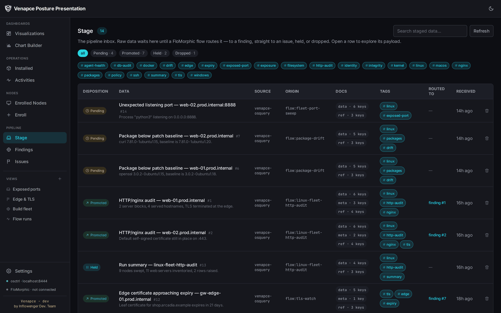
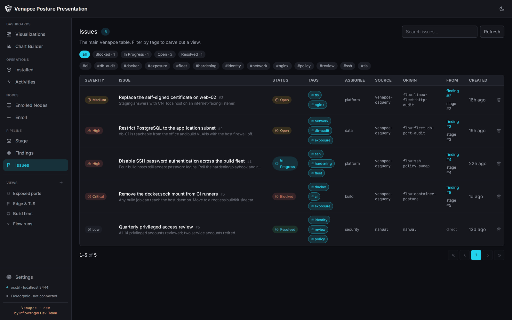
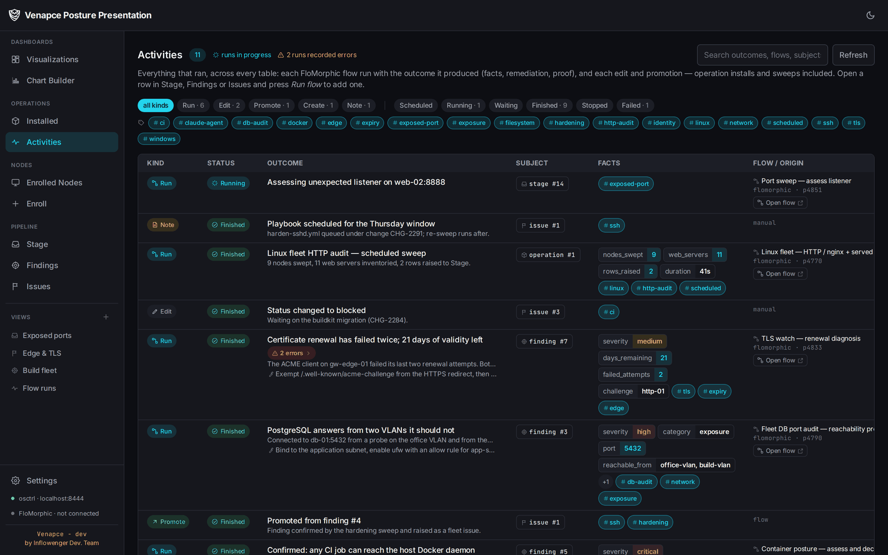
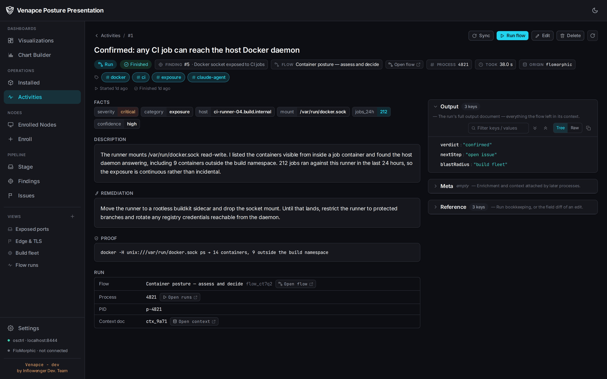
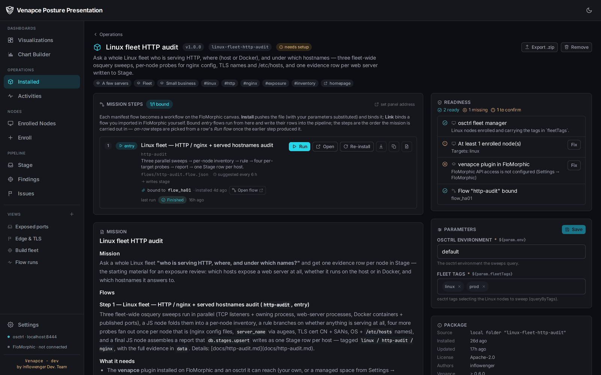
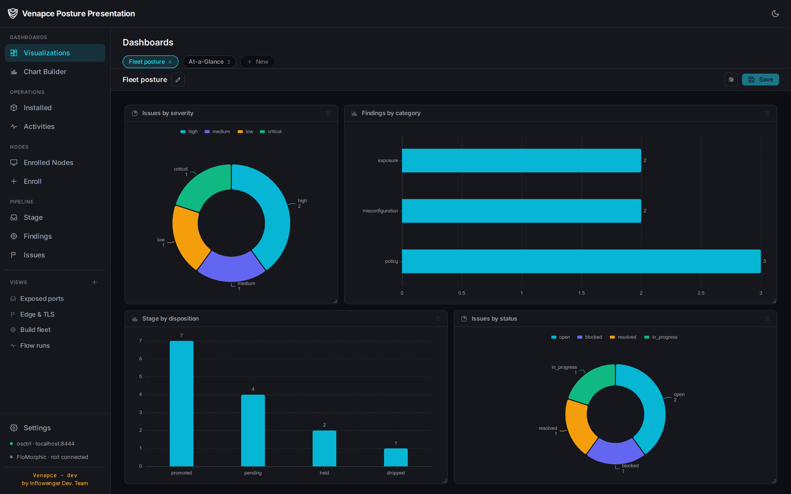

<div align="center">

# SurfStat

### Regulatory control, authored and evidenced

*A regulated process is a graph the compliance expert draws. The record of every run is the evidence.*

[Product page](https://inflowenger.com/surfstat) ·
[FloMorphic](https://inflowenger.com/flomorphic)

</div>

---

> **Status: early development.** SurfStat is past its feasibility study and being built now.
> This repo is the getting-started guide. The core — the pipeline, the package
> manager, the dashboard builder and access control — is in place; the pages
> marked *planned* below are not yet written.

## Quick start

One command. It checks for a FloMorphic instance (SurfStat runs as a FloMorphic
plugin), offers to install one if there isn't, wires in its shared secret, then
pulls and starts the SurfStat image:

```bash
curl -fsSL https://raw.githubusercontent.com/SurfStat/getting-started/main/install.sh | bash
```

or, from a clone of this repo:

```bash
./install.sh
```

Then open the panel at **http://localhost:8080** (Superset's own UI is on
**http://localhost:8090**).

**Signing in the first time.** On a fresh database SurfStat creates one
administrator and prints a generated password to the log, once:

```bash
docker compose logs surfstat | grep -A4 "administrator account"
```

Sign in with it and you are asked to change it immediately — the generated
value is a first-login credential, not a password, and it stops working the
moment you do. Set `SURFSTAT_ADMIN_PASSWORD` in `.env` beforehand if you would
rather choose your own and keep it out of the log.

Your first job in the panel is **Access**: create a second administrator. Four
actions in SurfStat need a second pair of eyes — amending a control, upgrading
a package, filing outward, and changing who may do any of it — and with only
one administrator there is nobody to be the second, so those actions are
refused rather than silently waved through.

On Windows, use [the PowerShell one-liner](#windows) instead — it puts WSL 2
and Docker Desktop in place first, then runs this same script inside WSL.

The installer writes the stack to `surfstat/` so you can manage it by hand
afterwards:

```bash
cd surfstat
docker compose logs -f          # follow the boot (first boot takes ~1–2 min)
docker compose down             # stop (keeps the data volume)
docker compose pull && docker compose up -d   # update the image
```

Drive it non-interactively with env vars (see the header of `install.sh` for the
full list) — for example:

```bash
FLOMORPHIC_MODE=existing FLOMORPHIC_JWT_SECRET=… ASSUME_YES=1 ./install.sh
```

### Windows

SurfStat is containers, and Docker on Windows is Docker Desktop on the WSL 2
backend — so the prerequisite is not just Docker, it is Docker *and* the Linux
environment it runs in. [`install.ps1`](./install.ps1) is that part. Run it from a
normal PowerShell:

```powershell
irm https://raw.githubusercontent.com/SurfStat/getting-started/main/install.ps1 | iex
```

It is not a port of `install.sh` — it is the step before it. It checks the host,
asks before it installs anything, and then runs the very same `install.sh` inside
WSL, so Windows and Linux end up with one stack from one source of truth:

| Step | What it does |
| --- | --- |
| **Windows** | build (19041+), architecture, and a warning when virtualization is off in firmware — the classic silent WSL 2 failure |
| **WSL 2** | installs it with your consent (`wsl --install`), installs Ubuntu if there is no distro, converts a WSL 1 distro, tells you when a reboot is needed |
| **Docker Desktop** | installs it with your consent (winget, else the installer from docker.com), starts it, waits for the engine, and walks you through **Settings → Resources → WSL integration** when the engine is up on Windows but invisible inside the distro |
| **`install.sh`** | runs it in the distro, forwarding every installer env var you set in PowerShell |

Installing WSL or Docker Desktop needs administrator rights; the script asks
before relaunching itself elevated. A fresh WSL install usually wants a reboot —
re-run the same one-liner afterwards and it carries on.

The stacks land in the distro's own filesystem (`~/surfstat` by default), **not**
on `C:`. The stack keeps Postgres (and a FloMorphic SQLite database, when it installs one) in bind mounts, and database file locking over the `/mnt/c` bridge is slow and prone to corruption. Explorer still reaches it:

```powershell
explorer.exe \\wsl$\Ubuntu\home\<you>\surfstat
wsl -d Ubuntu --cd ~/surfstat            # a shell where docker compose works
```

Docker Desktop publishes the ports to Windows, so **http://localhost:8080** works in your Windows
browser with nothing else to configure. Keep Docker Desktop running — the stack
stops and starts with its engine.

Env vars work the same way, as PowerShell env vars; `-Yes` (or `ASSUME_YES=1`)
makes the whole thing unattended:

```powershell
$env:FLOMORPHIC_MODE = 'new'; $env:ASSUME_YES = '1'
irm https://raw.githubusercontent.com/SurfStat/getting-started/main/install.ps1 | iex
```

To pass parameters (`-Distro`, `-InstallDir`, `-Ref`, `-NoInstall` to check without
installing), use the scriptblock form — a bare `irm | iex` cannot take arguments:

```powershell
& ([scriptblock]::Create((irm https://raw.githubusercontent.com/SurfStat/getting-started/main/install.ps1))) -Yes -Distro Ubuntu
```

> Docker Desktop is Docker Inc.'s product under
> [its own licence](https://docs.docker.com/subscription/desktop-license/) — free for
> personal use, education and small businesses; larger companies need a paid
> subscription. The script only installs it when you say yes.

Already running WSL with Docker Desktop integration on? Then the plain
`curl ... install.sh | bash` one-liner inside the distro is all you need; if docker
is missing there, `install.sh` now says which of the two is wrong.

### Pointing SurfStat at FloMorphic later

If you skipped the FloMorphic step — or your FloMorphic later moves — set its
address from the panel: **Settings → Connect FloMorphic → FloMorphic API**. It
takes the API URL, the shared JWT secret and the infra host, tests them, and
stores them in SurfStat's database, where they override `FLOMORPHIC_URL`,
`FLOMORPHIC_JWT_SECRET` and `INFRA_HOST` from the environment and survive a
container recreate. **Reset to environment** undoes the override.

Two things to keep in mind when editing `surfstat/.env` instead:

- Those values are read once at startup, and `docker compose restart` reuses the
  container's existing environment. Use `docker compose up -d` (a recreate) —
  restart will look like your edit was ignored.
- They are resolved *from inside* the container, so `localhost` is the container
  itself. A FloMorphic container on `inflow_net` is reached by its name
  (`http://flomorphic:8025`); one running on your host is reached at the Docker
  gateway (`docker network inspect inflow_net -f '{{range .IPAM.Config}}{{.Gateway}}{{end}}'`).

## What SurfStat is

Digitalising a regulatory control normally means a software release. Someone writes the rule down,
someone else implements it, and six weeks later the threshold is live — by which time the regulator
has amended it. Meanwhile the evidence that the control ran, and why it concluded what it did, is
assembled afterwards from logs that were never designed to answer the question.

SurfStat inverts both. A control is a diagram the compliance expert draws, and that diagram is what
actually runs. Editing it changes what runs tomorrow. And because the platform keeps the record
between steps, the audit trail is not a module anyone built — it is what executing the process
produces.

All business logic lives in [FloMorphic](https://inflowenger.com/flomorphic) workflows; SurfStat is
the product around them — the register, the queue, the evidence store and the access model that make
those workflows a regulated deployment rather than a set of diagrams.

```
Reach — connectors & the SurfStat plugin
  Core banking, the warehouse, a database in a branch office, a portal with no API.
  Each is reached where it already sits. Nothing is migrated.
        ↓
Judgment — FloMorphic workflows
  A rule step for what is deterministic, a policy step for a threshold, a calibrated
  decider for a classification, a human step where accountability must be personal.
  ALL business logic lives here.
        ↓
The product — SurfStat
  Intake, exceptions, cases, the activity log, packages, dashboards — and the
  access model, the clock and the retention rules the platform deliberately
  does not provide.
```

One ordering rule carries the whole discipline: **a check goes to the cheapest step that can carry
it.** Deterministic first, then a calibrated choice from a closed list, then open-ended reading, and
a person only where accountability has to be personal. A model is never used to pick between five
known answers, and never used for arithmetic.

## The data model: Intake → Exceptions → Cases

Six tables carry the model, with FloMorphic doing the judgment between them.

| Table | What it holds |
| --- | --- |
| **Intake** | The un-triaged inbox — extracts, feed results, uploads and probe output as they land, including the probes that returned nothing and the attempts that timed out. A control routes each row: *pending*, *promoted*, *held* or *dropped*. |
| **Exceptions** | What a control concluded but nobody has validated yet: a severity, a confidence, the obligation and entity it points at, and the evidence behind it. |
| **Cases** | The axis where work actually moves: remediation items, investigations, breach assessments — with an owner, a due date and a history. |
| **Activities** | The history of every row above: each control run with what it read, what it concluded and which path it took. This is the audit trail, and the screen you put in front of a supervisor. |
| **Operations** | Installed control packs: the manifest, the parameters this firm supplied, and the FloMorphic flows each one bound. |
| **Views** | A saved view — a named tag filter over any of the tables above, which the sidebar carries as its own entry. |

The three pipeline levels are **optional, not a sequence**. A control decides where a row lands: raw
data usually arrives on Intake, a later process turns it into an Exception when it concludes
something worth tracking, and an Exception that needs remediating becomes a Case. But a control may
write straight to Exceptions or Cases. Nothing forces the order — and the seam between *what was
collected* and *what was judged to matter* stays visible, which is precisely the seam a supervisor
interrogates.

Two pages should be quiet. **Intake** and the evidence store are insurance: their value is inversely
proportional to how often anyone opens them. Nobody reads Intake on a good day; it exists so that on
a bad day you can show exactly what the control saw.

Rows are **tagged rather than typed**. Rather than a table per case kind, every row carries tags and
a saved view is a tag filter over them. A new class of obligation needs no schema change — a new
regime is a label and a view, not a database migration.

A **dedup key chosen by the control** is how a nightly test recognises a repeat instead of
accumulating three hundred and sixty-five copies of one exception. The producer decides what counts
as the same thing again — control plus obligation plus entity plus period, typically.

Over all of it sits a **full chart and dashboard builder**. Compliance posture is not a fixed set of
screens: a coverage heat map, an obligation-coverage view and a breach-ageing report are the same
construction over the same rows.

## Access control

A compliance platform's access model is the second thing a supervisor asks about, right after the
audit trail. SurfStat's is built in rather than bolted on.

- **One catalog, one source of truth.** Every permission is declared once, in the backend. The Access
  screen renders itself from it, so there is no permission list duplicated in the front end to drift
  out of step.
- **Roles, plus per-user overrides.** Six roles ship as a starting point — administrator, compliance
  officer, analyst, approver, auditor, viewer — and any of them can be edited. On top of those, a
  single permission can be granted to or withheld from one person, with a mandatory reason and an
  optional expiry. **A deny always beats every role**, which is the one precedence rule and the
  reason a revocation is something you can reason about.
- **Separation of duties.** The catalog marks the four-eyes points: amending a control, upgrading a
  package, filing outward, and changing who may do any of it. Those actions do not execute when
  requested — they are recorded, and a second holder of the same permission, who did not request
  them, confirms them. The action then replays from the stored record rather than from whatever the
  first browser still had open.
- **Entity isolation.** A role can be scoped to a legal entity, branch or business line. One branch's
  data never reaches another's control run.
- **Instant revocation.** Sessions are rows, not self-contained tokens. Suspending someone ends their
  sessions on their next request — "we cannot sign that person out" is not an answer a regulated
  deployment can give.
- **Its own audit.** Every sign-in, grant, revocation and approval is recorded separately from the
  control-execution record: one is what controls did, the other is who was allowed to do it.

## Languages

The panel ships in **English, Persian and Arabic**, and switches direction with the language —
layout, alignment and flow mirror for the two right-to-left locales. The choice is stored against
the user account, so it follows them between machines.

Latin digits are used in every language by default. Iranian and Gulf banking both read Latin digits
in tables and figures, and a table where only some cells are Eastern Arabic is worse than either
choice made consistently. Statutory dates render in the Gregorian calendar whatever the interface
language, because that is the calendar the instrument setting the deadline used.

## Where the model sits, and where it does not

Some controls carry an AI step, and two properties make that acceptable in a regulated setting.

**It cannot invent an action.** The paths out of an AI step are the ones the author drew. The model
chooses among them and cannot add a third.

**It cannot refuse to answer.** A calibrated decider picks from a closed list, returns a probability
for every option including the ones it did not choose, and escalates to a named person when it
cannot clear its confidence floor. That floor is a field on a step, not a sentence in a prompt — and
the scores that failed it are attached to the escalation, so the handover is inspectable.

Arithmetic never goes near a model. Ratios, exposures and provisions run as code steps, reproducible
from the same inputs.

## What ships

SurfStat ships as a **single container image** — and behind it, one Postgres.

| Component | Role |
| --- | --- |
| **Go backend API** | The service the panel talks to, and the bridge to FloMorphic. |
| **Vue web app** | The panel: intake, exceptions, cases, the activity log, packages, access. Three languages, left-to-right and right-to-left. |
| **Dashboard builder** | A full chart and dashboard builder over the pipeline tables. |
| **nginx** | Front door, tying the web app, API, and dashboards behind one origin. |
| **PostgreSQL** | One database, shared by the dashboards and the backend API. |

## Onboarding: the systems you already run

Nothing is migrated into SurfStat. A control reaches each system where it already sits and answers
in place — a core banking system, a data warehouse, a document store, a database in a branch office,
or a portal with no usable API at all, which a browser-driving step works while every action it
takes goes on the record.

Three things to set up, once:

- **Connections.** Register each system as a named profile. Credentials live there, never on a
  canvas: a step refers to the profile by name, so no secret is ever drawn on a diagram.
- **Entities.** Your legal entities, branches and business lines. This is also where the isolation
  boundary sits — a role scoped to one entity never reaches another's data.
- **Obligations.** The register everything else hangs from: the instrument each obligation derives
  from, which entities it binds, who owns it, and how often it must be tested. Nothing else is
  created until this row exists, because every later artifact points back at it.

Then controls arrive as **packages** — a versioned, installable pack per obligation or control
family, with this firm's own thresholds, jurisdictions and materiality filled in at install time. A
readiness check runs first and names anything missing; a dry run plans the change and reports every
problem before anything lands. When the regulator amends the text, you take the new version and
binding-by-key replaces the right control even if someone renamed it on the canvas a year ago.

## How it's packaged

SurfStat ships as **one image on a permanent base image**:

| Image | Contents | Cadence |
| --- | --- | --- |
| **`mehdishokohi/surfstat-base`** | PostgreSQL · Superset (gunicorn, synchronous — **no Redis/Celery**) · nginx · supervisord | Rebuilt only when Superset or the base plumbing changes (`BASE_VERSION`) |
| **`mehdishokohi/surfstat`** | `FROM surfstat-base` + the `surfstat-api` Go backend + the compiled `surfstat-wapp` panel + the nginx front door | Every product release (`VERSION`) |

Everything runs in **one container**, supervised by supervisord, behind a single
origin:

```
:80   nginx ──► /         surfstat-wapp (Vue SPA)
              └► /api      surfstat-api (Go)  ─┐
:8088 (→ host :8090)  Superset (gunicorn)     │  one PostgreSQL, two databases:
                        └──────────────────────┴─►  surfstat  +  superset
```

- **One PostgreSQL** holds both the `surfstat` database (the backend's charts,
  dashboards, settings, intake/cases) and Superset's `superset` metadata database
  — Superset's metadata is Postgres, never sqlite.
- **No Redis, no Celery.** Superset is a synchronous BI engine here; its caches
  are a filesystem cache on the data volume. The async-only features (async SQL
  Lab, Alerts & Reports, thumbnails) are off.
- **FloMorphic** is reached over the shared `inflow_net` network at
  `flomorphic:8025`, authenticated with FloMorphic's shared secret — the installer
  captures it from the instance it finds or installs.

All state lives in one named volume (`surfstat-state` → `/var/lib/superset`).

## Building & publishing (maintainers)

The `Makefile` builds and pushes both images from the sibling `surfstat-api` /
`surfstat-wapp` checkouts (Docker Hub namespace `mehdishokohi`):

```bash
make base-build           # build surfstat-base:local (host arch)
make build                # build surfstat:local FROM the local base
make run                  # try it standalone on :8080 (+ Superset on :8090)

make login
make base-release BASE_VERSION=v2     # publish the base (multi-arch)
make release      VERSION=v0.1.0      # publish the product (multi-arch)
```

`make help` lists every target. A product release layers the Go binary and static
panel onto the existing base, so it doesn't recompile Superset.

## Screenshots

A walk through the panel. The rows and the control runs below are a demo
environment — the data is made up, the screens are not.

> Screenshots are being retaken for the regulatory vocabulary; several below
> still carry the labels from the product SurfStat was forked from.

**Intake — the un-triaged inbox.** Rows as they land, each carrying where its data
came from (`source`), which process produced it (`origin`) and the evidence it
brought with it. A control routes each one: *pending*, *promoted*, *held* or
*dropped* — and a promoted row links to what it became.



**Cases.** The main table: what needs validating, fixing or acting on. Every row is
tagged rather than typed, so a saved view is just a named tag filter — the four in
the sidebar are exactly that.



**Activities.** Everything that ran, across every table: each flow run with the
outcome it produced, plus the manual edits and promotions. A run that hit node
errors and finished anyway says so.



**One run, in full.** A control executed on one row, with its conclusion lifted
into typed fields — facts, description, remediation, the proof it rests on — and
the run's own output document beside them. This is the page that answers "why did
this control fail?" six months later, without anything being reconstructed.



**Packages.** The shipping unit: a control pack with its manifest, its parameters
filled in for your firm, a readiness list of what it still needs, and the flow it
bound on the canvas. When the regulator amends the text, the upgrade path runs
through here — as a dry run first.



**Dashboards.** Charts built on the pipeline tables themselves and arranged on a
drag/resize grid — rendered natively, no iframe. Coverage by regime, exceptions by
entity, ageing, testing throughput.



## Links

- **Product page:** https://inflowenger.com/surfstat
- **The runtime it runs on — FloMorphic:** https://inflowenger.com/flomorphic

---

<div align="center">
<sub>SurfStat · the regulatory-technology segment of Inflowenger, built the FloMorphic way. In development — dates and scope will shift.</sub>
</div>
